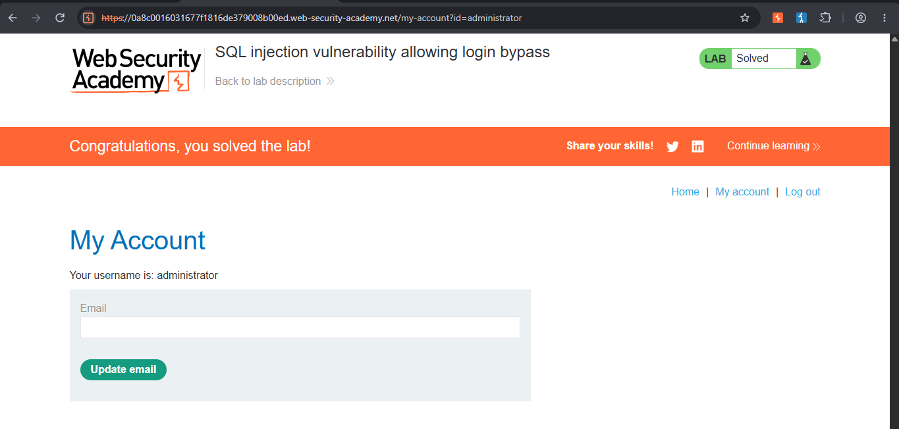

SQL Injection — Authentication Bypass via Comment Injection (PortSwigger Web Security Academy)

Lab: SQL injection vulnerability allowing login bypass
Category: SQL Injection
Difficulty: Apprentice
Status: Solved
Tools used: Web browser (login form)

Objective
Log in as the `administrator` user without knowing their password by exploiting a SQL injection vulnerability in the login form.

Hypothesis
The login form's username and password fields are used server-side to query the database and check credentials. Since this input directly feeds into a database query, it was worth testing whether the input was properly sanitized/parameterized, or whether injecting SQL syntax could manipulate the query's logic.

Steps

1. Submit a crafted username
In the login form, entered:
- Username: `administrator'--`
- Password: (any value — it turned out not to matter at all, e.g., `peter`)

2. Submit and observe the result
Logged in successfully as `administrator`, with full access to the admin account — despite never having the real password.



3. Confirm
Lab marked as solved.

Root Cause
The login form's backend likely builds a SQL query by directly concatenating the submitted username and password into a string, roughly equivalent to:
```sql
SELECT  FROM users WHERE username = 'administrator' AND password = 'peter'
```

Injecting `administrator'--` as the username turns this into:
```sql
SELECT  FROM users WHERE username = 'administrator'--' AND password = 'peter'
```

Two SQL syntax elements made this work:
- The `'` closed the username string early, immediately after `administrator`.
- `--` is a SQL comment marker — everything after it on that line is ignored by the database entirely.

As a result, the query the database actually executed was just:
```sql
SELECT  FROM users WHERE username = 'administrator'
```

The password check was not skipped because it was "wrong" — it was never evaluated at all, because the comment marker removed it from the query before the database ever processed it. Since a user matching `username = 'administrator'` exists, the query returned that row, and the application treated this as a successful, valid login.

Fix Recommendations
- Use parameterized queries (prepared statements) for all database access involving user input — never build SQL queries via string concatenation.
- Treat all user input as data, never as part of the query's logic/structure.
- Apply input validation as defense-in-depth (e.g. rejecting unexpected characters in a username field), though parameterized queries are the primary fix, not a substitute for it.
- Enforce least-privilege database accounts, so that even a successful injection has limited ability to access or modify data beyond what the application strictly needs.
